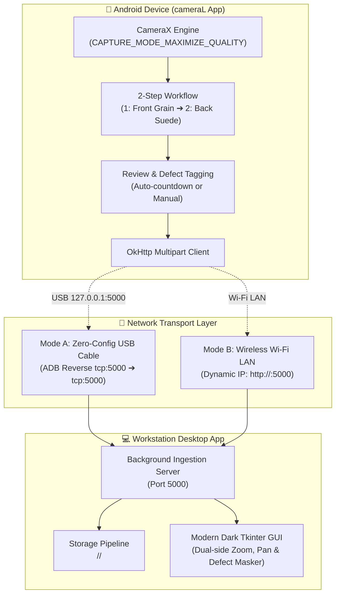

# ✦ Leather Capture Suite Pro (v2.0)

[](https://python.org)
[-green.svg?logo=android&logoColor=white)](https://developer.android.com)
[](https://kotlinlang.org)
[](https://developer.android.com/jetpack/compose)
[](https://developer.android.com/training/camerax)
[](https://opencv.org)
[](LICENSE)

An industrial dual-sided leather grading, dataset collection, and defect segmentation capture system. It bridges a high-resolution **Android mobile capture app** with a **PC workstation desktop tool** via **USB cable (ADB Reverse)** or **Local Wi-Fi LAN**.

---

## 📸 System Previews

### 1. Desktop Ingestion & Annotation Workstation (Dark Theme)
```text
+---------------------------------------------------------------------------------------------------+
| ✦ Leather Capture Pro   Save To: [ D:/Leather_Dataset_2026 ] [Browse] | [USB: Linked] [Wi-Fi: 192.168.1.15:5000] |
+---------------------------------------------------------------------------------------------------+
|  [✦ Side 1: Front (Grain)]   [✦ Side 2: Back (Suede)]     |  QUALITY GRADING & INSPECTION         |
| +-------------------------------------------------------+ |  Piece ID: Piece_20261124_221045      |
| |                                                       | |                                       |
| |                                                       | |  LEATHER GRADE:                       |
| |              [ HIGH-RES LEATHER HIDE ]                | |  (A)  (B)  (C)  (D)  (Waste)          |
| |              [ RED DEFECT MASK OVERLAY ]              | |                                       |
| |                                                       | |  PIECE SIZE: [ Medium           v ]   |
| |                                                       | |                                       |
| |                                                       | |  DEFECTS OBSERVED:                    |
| |                                                       | |  [x] Scratch      [x] Scar            |
| +-------------------------------------------------------+ |  [ ] Hole         [ ] Vein Marks      |
|  [Pen] [Eraser] Brush: --O-- 4px  [Undo] [Clear] [Fit]  |  [ ] Discoloration[ ] Wrinkles        |
|  Status: Received Piece_20261124_221045 from mobile.    |  [✓ Save Annotations & Masks]           |
+---------------------------------------------------------------------------------------------------+
```

### 2. Android Mobile App (Sleek Dark Mode)
```text
  +-------------------------------+      +-------------------------------+      +-------------------------------+
  | STEP 1: FRONT (GRAIN)  [⚡] [*]|      | STEP 2: BACK (SUEDE)   [⚡] [*]|      | STEP 3: REVIEW & UPLOAD       |
  | 127.0.0.1:5000       Pieces: 0|      | 127.0.0.1:5000       Pieces: 0|      | Auto-uploading in 2s...  (▶)  |
  +-------------------------------+      +-------------------------------+      +-------------------------------+
  |                               |      |               +-------------+ |      | +-----------+   +-----------+ |
  |       ┌───────────────┐       |      |               |Front Preview| |      | |   FRONT   |   |   BACK    | |
  |       │   ALIGN HIDE  │       |      |               +-------------+ |      | |  (GRAIN)  |   |  (SUEDE)  | |
  |       │  (GRAIN SIDE) │       |      |       ┌───────────────┐       |      | +-----------+   +-----------+ |
  |       └───────────────┘       |      |       │   FLIP HIDE   │       |      | Grade: [A] [B] [C] [D] [Waste]|
  |                               |      |       │ (FLESH/SUEDE) │       |      | Size:  [Small] [Medium] [L]   |
  |                               |      |       └───────────────┘       |      | Defects: [Scratch] [Hole]...  |
  |              (O)              |      |              (O)              |      | [Discard]  [UPLOAD PAIR NOW]  |
  +-------------------------------+      +-------------------------------+      +-------------------------------+
```

---

## ⚡ Core Architecture



---

## ✨ Features

- **Paired Two-Sided Capture**: Automatically enforces photographing both sides of each leather hide (**Side 1: Grain** and **Side 2: Flesh/Suede**) as a single atomic data record.
- **Dynamic Network Discovery (No Hardcoded IPs)**:
  - Dynamically resolves the PC's actual local LAN IP address on any router, Wi-Fi network, or mobile hotspot.
  - "Copy Wi-Fi URL" button in the desktop toolbar for instant sharing.
- **Zero-Config USB Cable Bridge**: Automatically configures `adb reverse tcp:5000 tcp:5000` so mobile captures transfer over USB at full hardware speeds without Wi-Fi latency.
- **Industrial CameraX Capture Engine**: Captures full-sensor, uncompressed JPEG images using hardware autofocus metering, tap-to-focus indicator, and flash toggle.
- **Built-in Connection Tester**: The Android app features a live connection testing tool in Settings to ping the PC server before taking shots.
- **Persistent Server Preferences**: The mobile app remembers your PC's IP address across reboots using `SharedPreferences`.
- **Dark Mode UI**: Professional AMOLED dark mode across both the Android application and the desktop workstation.
- **Dual-Side Defect Masking**: Interactive desktop canvas with Zoom (up to 16x), Pan, Pen, and Eraser to draw pixel-accurate defect masks for both front and back surfaces.
- **Arbitrary Save Folder**: Pick any directory on your computer (`D:\Leather_Projects\...`); preferences persist across sessions.

---

## 📁 Kaggle & ML-Optimized Dataset Structure

The dataset structure is designed specifically for **Kaggle EDA (Exploratory Data Analysis)**, PyTorch / TensorFlow pipelines, and computer vision segmentation models.

Whenever samples are received or masks are saved, the workstation automatically updates top-level tabular indexes (`metadata.csv` and `pieces_summary.csv`):

```text
<Dataset_Folder>/
├── metadata.csv                 # 📊 Master Kaggle index (1 row per image/mask sample)
├── pieces_summary.csv           # 📊 Paired leather hide summary (1 row per 2-sided piece)
├── images/                      # Centralized flat directory with all high-res photos
│   ├── Piece_20261124_201857_front.jpg
│   └── Piece_20261124_201857_back.jpg
├── masks/                       # Centralized flat directory with binary defect masks
│   ├── Piece_20261124_201857_front_mask.png
│   └── Piece_20261124_201857_back_mask.png
└── Piece_20261124_201857/       # Per-piece archive folder
    ├── front.jpg
    ├── back.jpg
    ├── front_mask.png
    ├── back_mask.png
    └── metadata.json
```

### 📊 Master Table Schema (`metadata.csv`)
Engineered with binary flags for instant correlation analysis, distribution plotting, and PyTorch dataset loading:

| Column | Type | Description |
| :--- | :--- | :--- |
| `sample_id` | string | Unique sample identifier (e.g. `Piece_20261124_201857_front`) |
| `piece_id` | string | Hide identifier uniting front & back pairs |
| `side` | string | `front` or `back` |
| `surface_type` | string | `Grain` (front) or `Suede` (back) |
| `image_path` | string | Relative path to image (`Piece_.../front.jpg` or `images/...`) |
| `mask_path` | string | Relative path to binary defect mask (PNG) |
| `has_mask` | int (0/1) | Whether defect mask exists |
| `grade` | string | Quality classification (`A`, `B`, `C`, `D`, `Waste`) |
| `size_category` | string | Hide size (`Small`, `Medium`, `Large`, `Full Hide`) |
| `has_defect` | int (0/1) | Binary classification target (1 = defective, 0 = clean) |
| `defect_count` | int | Total number of distinct defect classes found |
| `defect_scratch` | int (0/1) | One-hot binary indicator for scratch |
| `defect_hole` | int (0/1) | One-hot binary indicator for hole |
| `defect_discoloration` | int (0/1) | One-hot binary indicator for discoloration |
| `defect_scar` | int (0/1) | One-hot binary indicator for scar |
| `defect_wrinkle` | int (0/1) | One-hot binary indicator for wrinkle |
| `file_size_kb` | float | Image weight in kilobytes |
| `timestamp` | string | ISO-8601 acquisition timestamp |

---

## 📈 Instant Kaggle EDA (5-Line Start)

Load and explore the dataset in a Kaggle / Jupyter notebook in seconds:

```python
import pandas as pd
import seaborn as sns
import matplotlib.pyplot as plt

# 1. Load Master Table
df = pd.read_csv("dataset/metadata.csv")

# 2. Quality Grade Distribution
sns.countplot(data=df, x="grade", palette="viridis")
plt.title("Leather Quality Grade Breakdown")
plt.show()

# 3. Defect Frequency Analysis
defect_columns = [c for c in df.columns if c.startswith("defect_") and c != "defect_count"]
df[defect_columns].sum().plot(kind="barh", color="#EF4444")
plt.title("Defect Type Distribution")
plt.show()
```

You can also run the built-in starter script:
```powershell
python kaggle_eda_starter.py
```
```json
{
  "piece_id": "Piece_20261124_221045",
  "received_at": "2026-11-24T22:10:48.120Z",
  "front_image": "front.jpg",
  "back_image": "back.jpg",
  "grade": "A",
  "size_category": "Medium",
  "defect_types_present": [
    "Scratch",
    "Vein Marks"
  ],
  "notes": "Premium full-grain leather, minor scratch near edge.",
  "annotated_at": "2026-11-24T22:12:05.410Z"
}
```

---

## 🚀 Quick Start Guide

### 1. Workstation Setup (PC)

#### Prerequisites
- Windows 10/11, macOS, or Linux
- Python 3.10+
- Android SDK Platform-Tools (`adb`) — optional for USB mode

#### Installation
1. Clone the repository:
   ```powershell
   git clone https://github.com/your-username/Leather-Capture-Tool.git
   cd Leather-Capture-Tool
   ```
2. Install Python dependencies:
   ```powershell
   python -m pip install -r requirements.txt
   ```
3. Run the application:
   * **Windows**: Double-click `start_capture_tool.bat` (or run `python leather_capture_tool.py`).
   * **Linux / macOS**: `python3 leather_capture_tool.py`

---

### 2. Mobile App Setup (Android)

#### Prerequisites
- Android device running Android 8.0 (API 26) or higher.
- Android Studio Ladybug / Koala / Jellyfish (or newer).

#### Building & Installing
1. Open the Android project in Android Studio:
   `File > Open > Select AndroidStudioProjects/cameraL`
2. Connect your Android phone via USB and enable **USB Debugging** (*Settings > Developer Options > USB Debugging*).
3. Click **Run 'app'** (`Shift + F10`) or build the APK (`Build > Build APK(s)`).
4. *(Alternative)*: Double-click `install_apk_to_phone.bat` on your PC to install the prebuilt APK directly over USB.

---

## 🌐 Connecting Phone to PC

You can connect using either **USB Cable** or **Local Wi-Fi**:

| Feature | Mode A: USB Cable (Recommended) | Mode B: Wi-Fi LAN |
| :--- | :--- | :--- |
| **Speed** | ⚡ Ultra-fast (~150ms transfer) | 📶 Fast (depends on router) |
| **Setup** | Zero-config (Automatic via ADB) | Enter PC IP in app settings |
| **Server URL** | `http://127.0.0.1:5000` | `http://<YOUR_PC_IP>:5000` |
| **Ideal For** | Fixed grading desks, industrial work | Mobile operators walking large hides |

### Using Wi-Fi Mode
1. Ensure both your PC and phone are on the **same Wi-Fi network**.
2. Look at the top bar of the PC tool: note the **Wi-Fi URL** (e.g. `http://192.168.1.15:5000`) or click **"Copy Wi-Fi URL"**.
3. In the mobile app, tap the **Gear icon (Settings)** in the top right.
4. Paste or type the URL, tap **Test Connection** (turns green when verified), then tap **Save**.

---

## 🎮 Workflow Tutorial

1. **Step 1 — Front Side**:
   - Lay the leather hide on the table with the grain side facing up.
   - Align within the on-screen corner brackets $\rightarrow$ tap the red shutter. (Phone buzzes once).
2. **Step 2 — Back Side**:
   - Flip the hide over to the suede / flesh side.
   - Tap the red shutter again. (Phone buzzes once).
3. **Step 3 — Review & Auto-Upload**:
   - App displays both photos side-by-side with a 2-second countdown.
   - *(Optional)*: Select a Quality Grade (`A`, `B`, `C`, `D`, `Waste`) or tag defects (`Scratch`, `Scar`, etc.).
   - When the countdown finishes (or tap **Upload Pair Now**), photos upload directly to your PC.
   - Phone vibrates twice and immediately resets to **Step 1** for the next piece.
4. **Step 4 — Review & Mask on PC**:
   - The piece loads onto the PC workstation screen immediately.
   - Toggle between **Side 1 (Front)** and **Side 2 (Back)**.
   - Use the Defect Pen to highlight flaws.
   - Click **Save Annotations & Masks**.

---

## ⚙️ Configuration (`config.json`)

Customize grades, size options, and default defect tags by editing `config.json`:

```json
{
  "server_port": 5000,
  "output_directory": "dataset",
  "grades": ["A", "B", "C", "D", "Waste"],
  "size_categories": ["Small", "Medium", "Large", "Full Hide", "5ft", "6ft", "7ft", "8ft", "9ft", "10ft", "11ft", "12ft"],
  "defect_types": [
    "Scratch",
    "Hole",
    "Discoloration",
    "Scar",
    "Wrinkle",
    "Vein Marks",
    "Lamp Skin",
    "Spots",
    "Color Variation"
  ],
  "text_fields": ["thickness_mm", "operator_name", "batch_id"]
}
```

---

## 🛠️ Troubleshooting

- **"Failed to connect to /127.0.0.1:5000"**:
  - The PC desktop tool is not running. Double-click `start_capture_tool.bat` on your PC first.
  - If using USB, make sure USB Debugging is turned on and authorized on your phone.
- **"Connection Refused on Wi-Fi"**:
  - Make sure the phone and PC are connected to the same Wi-Fi router.
  - Tap **Settings (Gear icon)** in the app $\rightarrow$ verify your PC's IP address $\rightarrow$ tap **Test Connection**.
  - Ensure Windows Defender Firewall allows Python through private networks.
- **OpenCV not found on PC**:
  - Run: `python -m pip install -r requirements.txt`. Even without OpenCV, captures will still be received and safely saved to your designated folder.

---

## 📄 License

This project is licensed under the [MIT License](LICENSE).
